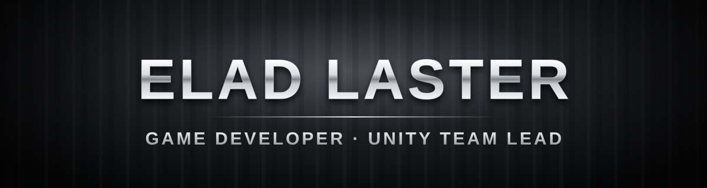
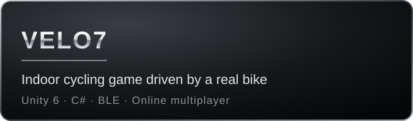
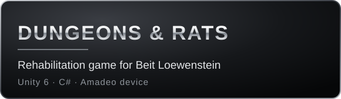
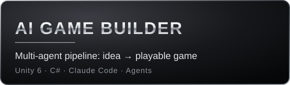

  

  
  
  

---

### 👋 About me

Game developer and **Unity Team Lead at [Neoja](https://neoja.com)**, where my team builds 20+ real-time interactive games for basketball courts, with multi-screen displays, floor projections and real hardware.

- 🎮 Gameplay systems, performance optimization and live production games
- 🔌 Connecting games to the real world: computer vision, BLE sensors, MQTT, custom hardware
- 🤖 AI-assisted development and multi-agent workflows
- 🎓 B.Sc. in Computer Science & Mathematics, Ariel University

---

### 🕹️ Featured projects

  
  

  
  

🔒 Some projects are private. Demos and code walkthroughs are available on request.

---

### 🛠️ Tech

  
  
  
  
  
  
  
  
  
  

